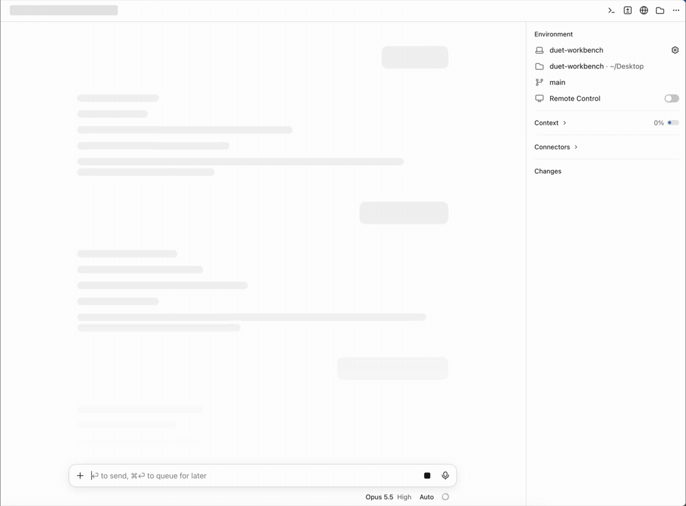
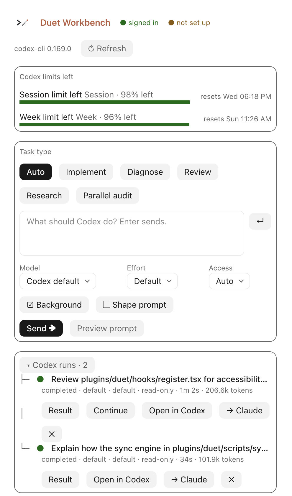

<p align="center">
  
</p>

<h1 align="center">Duet Workbench</h1>

<p align="center">
  Hand work to OpenAI Codex without leaving Claude Code.
</p>

<p align="center">
  <a href="https://github.com/OrangeArti/duet-workbench/actions/workflows/ci.yml"></a>
  <a href="LICENSE"></a>
  
  
</p>

A Claude Code plugin for handing work to OpenAI Codex from Claude Code, in the terminal and in the Code tab of the desktop app. It adds a delegation panel, prompts shaped for current Codex models, and a one-step project setup that copies a project's Claude rules and security settings to Codex.

Modified from [openai/codex-plugin-cc](https://github.com/openai/codex-plugin-cc) (Apache-2.0); see `NOTICE`. Not affiliated with or endorsed by OpenAI or Anthropic.

<p align="center">
  
</p>

## What you get

- **A panel** beside the chat: write a task, pick model and effort, watch runs, read results.
- **Safe write runs**: Codex edits in its own git worktree; you apply or discard the result.
- **One-step project setup**: your Claude rules and restrictions are copied to Codex, never loosened, and removed without a trace.
- **Quota at a glance**: Codex session and weekly limits left, tokens spent per run.
- **Claude knows what Codex did**: ask in the chat about any run.

<p align="center">
  
</p>

## How it differs from the official plugin

Duet Workbench started from [openai/codex-plugin-cc](https://github.com/openai/codex-plugin-cc) and keeps its commands. Compared with its v1.0.6:

| | `openai/codex-plugin-cc` | Duet Workbench |
|---|---|---|
| Where you work | Slash commands | Slash commands, plus a panel beside the chat |
| Write runs | Codex edits your working tree | Codex edits its own git worktree; you apply or discard |
| Your project's rules | Not passed to Codex | Claude rules and restrictions mirrored to Codex, never loosened |
| Codex permission profile | Replaced by a fixed sandbox mode | Project profile kept |
| Models | GPT-5.x names | Live model list, prompts shaped for GPT-6 |
| Quota | Not shown | Session and weekly limits left, tokens per run |
| Undo | — | `/duet:remove` restores the project exactly |

## Requirements

- Claude Code with plugin support, Node 18.18 or newer.
- The Codex CLI, 0.159.0 or newer, signed in: `codex login`.

## Install

```
/plugin marketplace add OrangeArti/duet-workbench
/plugin install duet@duet-workbench
```

From a local clone, give the folder instead:

```
/plugin marketplace add /path/to/duet-workbench
/plugin install duet@duet-workbench
```

To try it without installing: `claude --plugin-dir plugins/duet`.

If you use the official `codex@openai-codex` plugin, disable it once `duet` works: both register the same kind of commands and subagent.

### Updating

Installed from GitHub, Claude Code checks the marketplace when it starts and picks up a new version by itself. To update right away:

```
/plugin marketplace update duet-workbench
/plugin update duet@duet-workbench
```

then start a new session or run `/reload-plugins`. Installed from a local folder, the plugin is read from that folder: edits show up in the next session or after `/reload-plugins`. What changed is in [`plugins/duet/CHANGELOG.md`](plugins/duet/CHANGELOG.md).

## Use

- **Panel.** Press `Duet Workbench` above the prompt, or run `/duet`. Write the task, press Enter or Send. `↻ Refresh` in the header re-reads sign-in, models and runs.
- **Task type.** Auto reads the type off the task's words; or pick Implement, Diagnose, Review, Research or Parallel audit. Preview shows the exact prompt before it is sent, and you can edit it. Shape prompt (off by default) rewrites the task into a structured prompt for the chosen type and gives the run a short name.
- **Access.** Auto by default: a task that asks for a change ("fix…", "add…", «почини…») runs with Write, anything else Read-only; when the words are unclear it stays Read-only. Pick Read-only or Write yourself to fix it either way. With Write, Codex edits in its own git worktree (`duet/<job-id>`); Apply brings the changes into your working tree staged, Discard drops them.
- **Limits.** Two bars show how much of the Codex session (5-hour) and weekly quota is left, in percent, with the reset time. Each run's row shows the tokens it spent.
- **Same thread.** Continue on the last run adds a ticked "Same Codex thread" box above Send: the next task goes into that conversation. Untick it to start fresh. Access is chosen anew for every message, so a thread can go from writing to reading and back. Once a thread has two or more runs, History shows the whole conversation; `/duet history` prints it in the main window.
- **Run rows.** Each run is listed by what was asked. `→ Claude` puts a reference to the run into Claude's prompt box without sending it, so you can add your question. The red `✕` removes a run from the list after a confirmation (a run with unapplied changes loses them; the conversation stays in Codex). Result and History open the output right under the panel header. A short one leaves the rest of the panel in place; one taller than the panel is read on its own: `↓ Bottom` and `↑ Top` jump between its ends, and `Close` (at either end) brings the rest of the panel back.
- **Asking Claude.** Claude can read every Codex run of the project on its own (the `codex-runs` skill): ask it in the chat what a run did or how far it is.
- **Runs.** Every Codex run of the project is listed with its state, whether it was started from the panel, by `/duet:delegate` or from a shell. A toast tells you when one finishes. Press the `▾ Codex runs` header to fold the list to one line when it gets long; folded, it still shows how many runs are going.

| Command | What it does |
| --- | --- |
| `/duet` | Open the panel |
| `/duet history [job-id]` | Print the whole Codex conversation of a run (the last one by default) |
| `/duet:delegate` | Hand a task to Codex; read-only unless `--write` |
| `/duet:jobs`, `/duet:result`, `/duet:cancel` | List runs, show a result, stop a run |
| `/duet:init` | Set this project up for Codex: mirror its Claude rules and security settings |
| `/duet:sync` | Bring Codex's copy up to date after the Claude rules changed |
| `/duet:doctor` | Check prerequisites, differences and coverage; changes nothing |
| `/duet:remove` | Take Duet Workbench out of the project and restore the files it changed |
| `/duet:review`, `/duet:adversarial-review` | Codex reviews the local changes |

## Project setup (the mirror)

`/duet:init` copies restrictions from `CLAUDE.md` and `.claude/settings*.json` into `AGENTS.md` and `.codex/`. It shows a preview first. It only ever copies restrictions: it never loosens the sandbox, never bypasses hook trust, and never edits `.claude/` or `CLAUDE.md`. Everything it writes is recorded in a ledger, and `/duet:remove` restores the project exactly. A project that was never set up is left alone, apart from a one-line offer when it has security rules.

Limits: rules that match a command prefix see only the shell line Codex runs; the hard boundary is the filesystem denies and the network being off. `docs/sync-mapping.md` lists what maps to what.

## Where things are kept

Job records and write-run worktrees live in `~/.duet-workbench/state`, per project. Nothing is written into a project except by `/duet:init` and `/duet:sync`. Delete `~/.duet-workbench` after uninstalling to remove the records.

## Turning it off

- Whole plugin: `/plugin disable duet@duet-workbench`, or `/plugin uninstall duet@duet-workbench`.
- One project: `/duet:remove`, then answer "Never here" to the setup offer.
- Disabled, the plugin adds nothing to Claude Code. The run history stays in `~/.duet-workbench/state` and is back when you enable it again.

The stop-time review gate (`/duet:setup --enable-review-gate`) is off by default. It makes Codex review every turn before Claude stops, which spends Codex quota on each turn; turn it on only if you want that.

## Troubleshooting

- Run `/duet:doctor`. It names what is missing: the Codex CLI, sign-in, or an out-of-date mirror.
- "not signed in": run `codex login` in a terminal.
- Codex asks to trust the project or its hooks the first time: that prompt is Codex's own and only you can answer it.

## Security

See `SECURITY.md` for how to report a problem and what the mirror does and does not guarantee.

## Development

```bash
node --test tests/*.test.mjs
claude plugin test plugins/duet
claude plugin validate plugins/duet
```

No runtime dependencies: plain Node ESM. Open source under the Apache License 2.0 (see `LICENSE`): free for any use. The runtime is modified from `openai/codex-plugin-cc`, also Apache-2.0 (see `NOTICE`).
